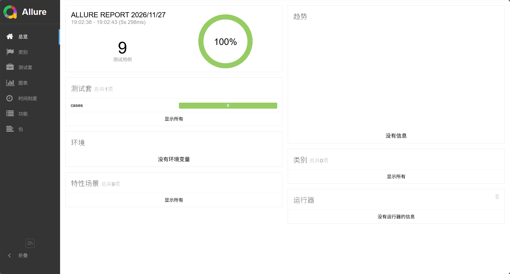
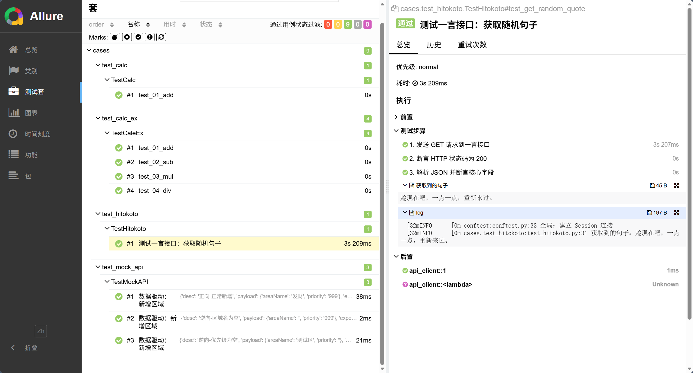

# 基于 Pytest + Requests 的接口自动化测试框架


## 📖 项目简介

本项目是一个基于 Python 的接口自动化测试框架，用于测试公开 API 接口及本地 Mock 服务。

框架采用**分层架构**（接口封装层 / 用例层 / 配置层 / 数据层 / 工具层），实现了**数据驱动、环境切换、统一日志与持续集成**，旨在快速验证接口的稳定性和正确性。

## 🛠️ 技术栈

- **语言**：Python 3.15
- **测试框架**：pytest 9.2
- **网络请求**：requests 2.34
- **测试报告**：allure-pytest 2.16
- **Mock 后端**：Flask 3.1
- **持续集成**：GitHub Actions

## 📁 项目结构

```
pytest-api-framework/
├── api/                 # 接口封装层（只负责发请求，不含断言）
│   ├── calc.py          # 计算器功能封装
│   └── hitokoto.py      # 一言接口 API Object
├── cases/               # 测试用例层
│   ├── test_calc.py
│   ├── test_calc_ex.py
│   ├── test_hitokoto.py
│   └── test_mock_api.py # 数据驱动用例
├── config/              # 配置层
│   └── settings.py      # 多环境配置 + 环境切换
├── data/                # 测试数据
│   └── mock_area_cases.json
├── utils/               # 工具层
│   └── logger.py        # 日志封装（控制台 + 文件双输出）
├── mock_server/         # 自研 Flask Mock 服务
│   └── app.py
├── .github/workflows/   # 持续集成
│   └── tests.yml
├── conftest.py          # fixtures（Session 复用 / Mock 服务自动启停）
├── pytest.ini           # pytest 配置
├── requirements.txt     # 顶层依赖
└── README.md
```

## 🚀 核心亮点

1. **分层架构（解耦）**：`api` 层只负责发请求并返回结果，断言全部放在 `cases` 层，职责清晰、易于维护。
2. **数据驱动**：测试数据抽离到 `data/*.json`，通过 `@pytest.mark.parametrize` 驱动，**新增用例只需改数据，不用改代码**。
3. **配置与代码分离**：`config/settings.py` 集中管理各环境地址，通过环境变量 `ENV` 一键切换 `test / staging / prod`，改地址不动业务代码。
4. **测试自包含**：`conftest.py` 中的 fixture 自动启动 / 关闭 Flask Mock 服务，`pytest` 一条命令即可跑通全部用例，**无需手动准备环境**。
5. **统一日志**：基于 `logging` 封装，控制台输出 `INFO` 以上、文件记录 `DEBUG` 全量；格式含**时间 + 级别 + 文件名 + 行号**，便于问题定位。
6. **Session 复用**：`scope="session"` 的全局 `api_client` 复用 `requests.Session`，减少重复建立连接的开销。
7. **持续集成**：GitHub Actions 在每次 push / PR 时自动安装依赖并运行全部测试，保证代码质量。
8. **写后读校验**：新增类接口测试不仅校验返回状态码，还会回查列表接口，验证数据**真正落库**。

## ⚙️ 环境切换

框架支持多环境配置，默认使用 `test`：

```bash
# Windows PowerShell
$env:ENV="prod"

# macOS / Linux
export ENV=prod
```

| 环境 | 说明 |
|---|---|
| `test` | 本地测试环境（默认，指向本地 Mock 服务） |
| `staging` | 预发布环境 |
| `prod` | 生产环境 |

## 💻 本地运行指南

**1. 克隆项目到本地：**

```bash
git clone https://github.com/shatong798/pytest-api-framework.git
cd pytest-api-framework
```

**2. 安装依赖包：**

```bash
pip install -r requirements.txt
```

**3. 运行测试并生成报告：**

```bash
pytest
```

**4. 查看可视化报告：**

```bash
allure serve report
```

## 📝 测试用例清单

| 用例文件 | 数量 | 覆盖内容 |
|---|---|---|
| `test_calc.py` | 1 | 计算器加法 |
| `test_calc_ex.py` | 4 | 加 / 减 / 乘 / 除 |
| `test_hitokoto.py` | 1 | 一言公开接口（真实 HTTP 请求） |
| `test_mock_api.py` | 3 | 数据驱动：1 条正向 + 2 条逆向（参数为空校验） |
| **合计** | **9** | |

## 🤖 持续集成（CI）

项目已接入 GitHub Actions：

- **触发条件**：push 到 `main` 分支，或向 `main` 提交 Pull Request
- **执行流程**：检出代码 → 安装 Python → 安装依赖 → 运行 `pytest`
- **运行环境**：`ubuntu-latest`（每次均为干净虚拟机，可顺带验证依赖完整性）

每次提交后可在 [Actions 页面](https://github.com/shatong798/pytest-api-framework/actions) 查看运行结果。

## 📸 测试报告展示



